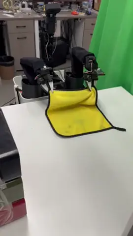
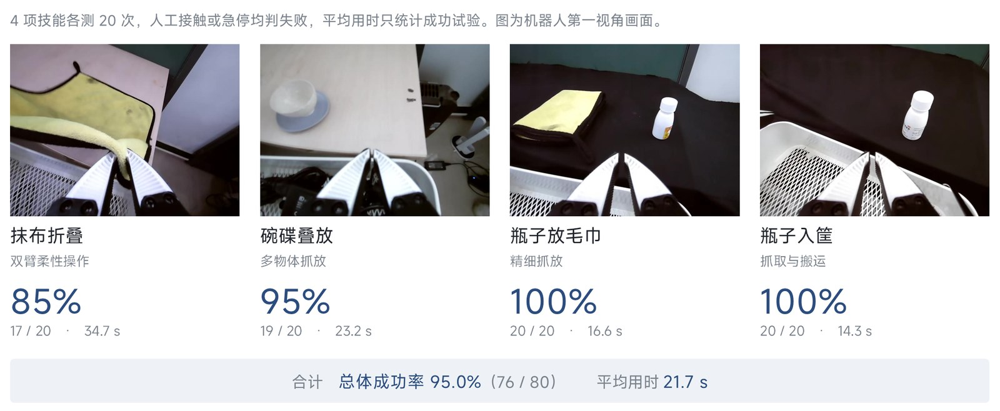
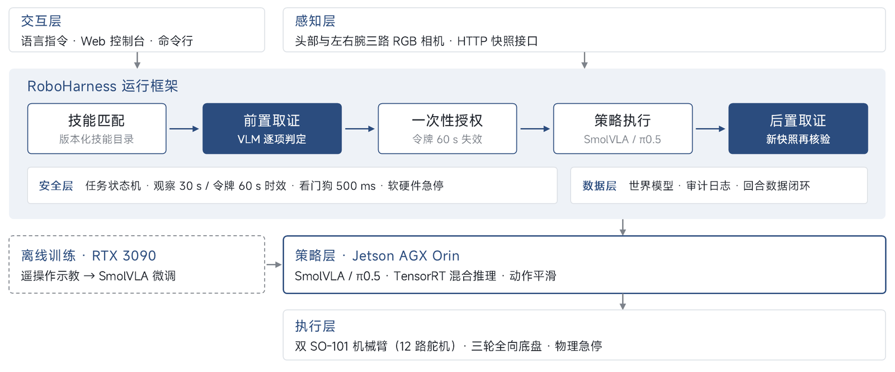
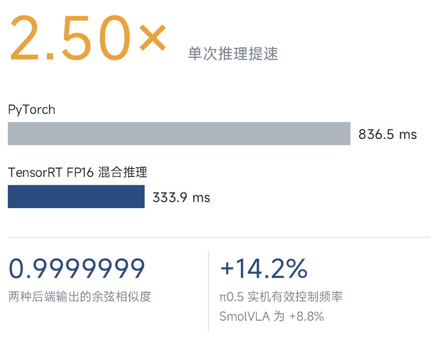
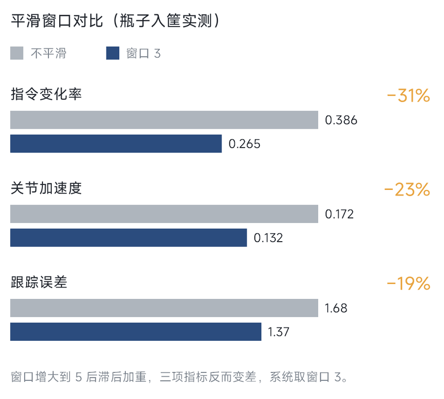

<div align="center">

# XLeRobot Household

**具身智能居家服务机器人：端侧 VLA 部署与证据门控运行框架**

[](https://github.com/yechya/xlerobot-household/actions/workflows/ci.yml)
[](LICENSE)




<sub>实机演示（5 倍速）：双臂折叠抹布 → 底盘移动到桌边 → 拉开抽屉收纳</sub>

</div>

基于开源 [XLeRobot](https://github.com/Vector-Wangel/XLeRobot) 套件搭建的双臂移动服务机器人。整机只用三路普通 RGB 相机，
在 NVIDIA Jetson AGX Orin 上本地运行 SmolVLA / π0.5 视觉-语言-动作（VLA）策略，完成抹布折叠、碗碟叠放等桌面家务。
本仓库包含：

- **RoboHarness 运行框架**（[`robot-agent/`](robot-agent/README.md)）：把学习策略和底盘封装成可审计的技能，每次执行前后由视觉语言模型对三路图像逐项取证，证据不足即拒绝执行。
- **端侧部署补丁**（[`integrations/`](integrations/lerobot_jetson/README.md)）：LeRobot 的 XLeRobot 接入，以及 SmolVLA、π0.5 的 TensorRT 混合推理，以可审阅补丁的形式提供。
- **实验分析**（[`analysis/`](analysis/README.md)）：推理加速、控制频率、动作平滑和抖动分析的复算脚本与结果。

> **English.** A dual-arm mobile household robot built on XLeRobot that runs SmolVLA / π0.5 locally on a Jetson AGX Orin
> with three RGB cameras. The repository contains RoboHarness, an evidence-gated runtime in which a vision-language model
> checks every skill before and after execution; LeRobot patches for TensorRT hybrid inference on Jetson (SmolVLA inference
> 2.50× faster); and the scripts that recompute the reported measurements from the recordings.
> The four household skills succeed in 76 of 80 real-robot trials.

## 主要结果

| 项目 | 结果 |
| --- | --- |
| SmolVLA 单次推理（Jetson AGX Orin） | PyTorch 836.5 ms → TensorRT FP16 混合推理 333.9 ms，提速 2.50 倍，输出余弦相似度 0.9999999 |
| 实机有效控制频率 | SmolVLA 11.35 → 12.35 Hz（+8.8%），π0.5 10.23 → 11.68 Hz（+14.2%） |
| 动作平滑（窗口 3） | 指令变化率 −31%，关节加速度 −23%，跟踪误差 −19% |
| 实机任务 | 4 项技能各测 20 次，成功 76 次（95.0%），成功试验平均用时 21.7 s |
| 运行框架 | 367 项单元与集成测试，语句覆盖率 73% |

<p align="center"></p>

测试条件和逐项数据见 [docs/results.md](docs/results.md)，复现脚本见 [analysis/](analysis/README.md)。

## 系统组成

<p align="center"></p>

一条语言指令依次经过技能匹配、前置取证、一次性授权、策略执行和后置取证，任一环节不通过即终止。策略在 RTX 3090 上
微调、在 Jetson 上推理；底盘和双臂由独立的安全层监管（任务状态机、看门狗、软硬件急停）。

### 去噪解码混合加速

SmolVLA 每输出一段 50 步动作，动作专家要迭代去噪 10 次，这部分占了推理时间的大头。我们只把这段解码编译为
TensorRT FP16 引擎，视觉-语言前缀仍由 PyTorch 计算并缓存。部署时用 `--policy.tensorrt_engine_path` 指定引擎，
即切换到 TensorRT 后端。

<p align="center"></p>

代码：[integrations/lerobot_jetson](integrations/lerobot_jetson/README.md)（SmolVLA）、
[integrations/lerobot_pi05](integrations/lerobot_pi05/README.md)（π0.5）。

### 三层误差模型与动作平滑

逐帧对比指令与实际关节角，把抖动拆成固定噪声、动作块切换期的不确定性和舵机跟踪误差三部分。跟踪误差与指令
变化率的相关系数为 0.942，与动作幅度只有 0.009：抖动来自指令变得太快，而不是动作太大。据此在输出端加入窗口为 3
的滑动平均（`--action_smoothing_window=3`）。

<p align="center"></p>

### 证据门控运行框架 RoboHarness

| 环节 | 做法 |
| --- | --- |
| 技能匹配 | 语言指令对应到版本化技能目录条目；新增技能只加目录项，不改框架代码 |
| 前置取证 | 采集三路快照，视觉语言模型逐项给出 pass / fail / unknown 和置信度；任一项不是 pass 或低于阈值（0.80～0.90）即拒绝 |
| 一次性授权 | 操作者输入确认字符串后签发令牌，60 s 有效，绑定 30 s 内的观察结果，用后作废 |
| 策略执行 | 加载前校验权重 SHA-256 指纹；看门狗 500 ms 超时即停，软件与物理双急停 |
| 后置取证 | 重新拍摄，要求快照哈希与执行前不同，确认任务完成；任务链节点最多重试 3 次 |

每次真实执行都会生成一条不可修改的回合记录（策略指纹、环境标签、结果、失败阶段、原始证据哈希），用于失败分流和
补采。设计与接口见 [robot-agent/README.md](robot-agent/README.md) 和 [robot-agent/docs/architecture.md](robot-agent/docs/architecture.md)。

## 仓库结构

```text
.
├── robot-agent/            RoboHarness：robotd 守护进程、robotctl、Web 控制台与 367 项测试
│   └── plugins/            回放、分割等可选插件
├── integrations/
│   ├── lerobot_jetson/     LeRobot 0.3.3 的 XLeRobot 接入与 SmolVLA TensorRT 补丁
│   └── lerobot_pi05/       π0.5 的 TensorRT 导出、量化与验证补丁
├── analysis/               实验数据的复算脚本与结果
├── docs/                   结果汇总、硬件清单、复现指南、评测协议、安全与隐私说明
└── scripts/                环境快照与文档链接检查
```

## 快速开始

运行框架不需要真机即可安装和测试。默认处于演练状态，不向硬件发送任何指令。

```bash
cd robot-agent
python -m venv .venv && source .venv/bin/activate
pip install -e '.[dev]'
pytest -q                               # 367 passed

robotd &                                # 启动守护进程
robotctl status
robotctl dry-run "把瓶子放进筐里"       # 匹配到 pick_up_bottle；未接相机时前置取证不通过，任务被拒绝
robot-web                               # 浏览器打开 http://127.0.0.1:8765
```

连接真机、训练策略和编译 TensorRT 引擎的完整步骤见 [复现指南](docs/reproduction.md)。

## 硬件

| 部件 | 配置 |
| --- | --- |
| 机械臂 | 2 条 SO-101 六自由度机械臂（12 个飞特 STS3215 磁编码总线舵机），另配 2 条主臂用于示教 |
| 底盘 | 三轮全向底盘，轮间 120°，控制板负责速度闭环和失联停车 |
| 相机 | 3 路 640×480 USB RGB 相机：头部俯视台面，左右腕部提供手眼视角 |
| 计算 | NVIDIA Jetson AGX Orin（JetPack 6、CUDA 12.6、TensorRT 10.3） |
| 安全 | 物理急停开关，直接切断执行机构动力 |

物料清单与接线见 [docs/hardware_bom.md](docs/hardware_bom.md)。

## 模型权重与数据

本仓库不包含训练好的权重和数据集。权重是在固定的相机安装、光照和桌面布置下用示教数据微调的，换一台机器或换一个
场景基本无法直接使用；复用需要重新采集、标定和训练，流程见 [docs/model-weights.md](docs/model-weights.md)。

## 文档

| 文档 | 内容 |
| --- | --- |
| [实验结果](docs/results.md) | 推理加速、控制频率、平滑、抖动和实机任务的完整数据 |
| [复现指南](docs/reproduction.md) | 从零安装、dry-run、硬件闭环、训练与 TensorRT 流程 |
| [已验证环境](docs/environment.md) | JetPack、CUDA、TensorRT、PyTorch 的实测版本 |
| [评测协议](docs/benchmarking.md) | 成功率、Wilson 区间、失败分类与报告模板 |
| [已知边界](docs/known-limitations.md) | 未实现的能力、安全边界与复现缺口 |
| [硬件在环与急停](docs/hil-evidence.md) | 真实硬件安全验收场景与记录格式 |
| [隐私与数据流](docs/privacy.md) | 相机快照、VLM 端点、留存与脱敏 |
| [安全策略](SECURITY.md) / [贡献指南](CONTRIBUTING.md) | 漏洞报告、安全不变量与提交规范 |

运行框架的专题文档在 [robot-agent/docs/](robot-agent/docs/)：任务目录、策略注册表、桌沿对接、任务编排、世界模型、
Web 控制台、数据采集等。

## 待更新（to be updated）

以下内容已写入项目论文，代码、数据或复现材料整理并核实后再补充到本仓库：

| 论文中的内容 | 论文位置 | 状态 |
| --- | --- | --- |
| Isaac Sim 数字孪生（17 个自由度、三路虚拟相机） | 第二节（三）、图2 | to be updated |
| ManiSkill 物体入筐仿真任务 | 第二节（三） | to be updated |
| MuJoCo 视觉取证场景与证据门控验证（表3） | 第二节（三）、第六节（三） | to be updated |
| π0.5 的 BF16 / 全量化 INT8 / 仅权重 INT8 引擎数值验证 | 第四节（二） | to be updated |
| 固定噪声 ε 的估计、块间插值过渡 | 第四节（三） | to be updated |
| 分层智能体架构（安全层、技能层、判断层、监督循环） | 第五节（一） | to be updated |
| 50 条家务指令覆盖测试与分级技能路线图 | 第六节（二） | to be updated |
| 真机—仿真—真机自主数据采集框架 CREATE | 第七节 | to be updated |
| 免训练抓取规划框架 TiPToP | 第八节 | to be updated |

## 项目与团队

本项目为南京大学国家级大学生创新训练计划项目「具身智能居家服务机器人」（项目编号 202610284032），由南京大学电子
科学与工程学院叶初阳（负责人）、雷季晓、孙艺珊、樊羽翼完成，指导教师杜源副教授。

项目建立在以下开源工作之上：[XLeRobot](https://github.com/Vector-Wangel/XLeRobot)、
[LeRobot](https://github.com/huggingface/lerobot)、[SmolVLA](https://huggingface.co/lerobot/smolvla_base)、
[openpi（π0.5）](https://github.com/Physical-Intelligence/openpi) 与 NVIDIA TensorRT。

## 引用

```bibtex
@software{xlerobot_household_2026,
  title  = {XLeRobot Household: Edge VLA Deployment and an Evidence-Gated Runtime for a Dual-Arm Household Robot},
  author = {Ye, Chuyang and Lei, Jixiao and Sun, Yishan and Fan, Yuyi},
  year   = {2026},
  url    = {https://github.com/yechya/xlerobot-household}
}
```

## 许可证

[Apache-2.0](LICENSE)。`integrations/` 中的补丁修改自 LeRobot（Apache-2.0），第三方组件的声明见 [NOTICE](NOTICE)。
