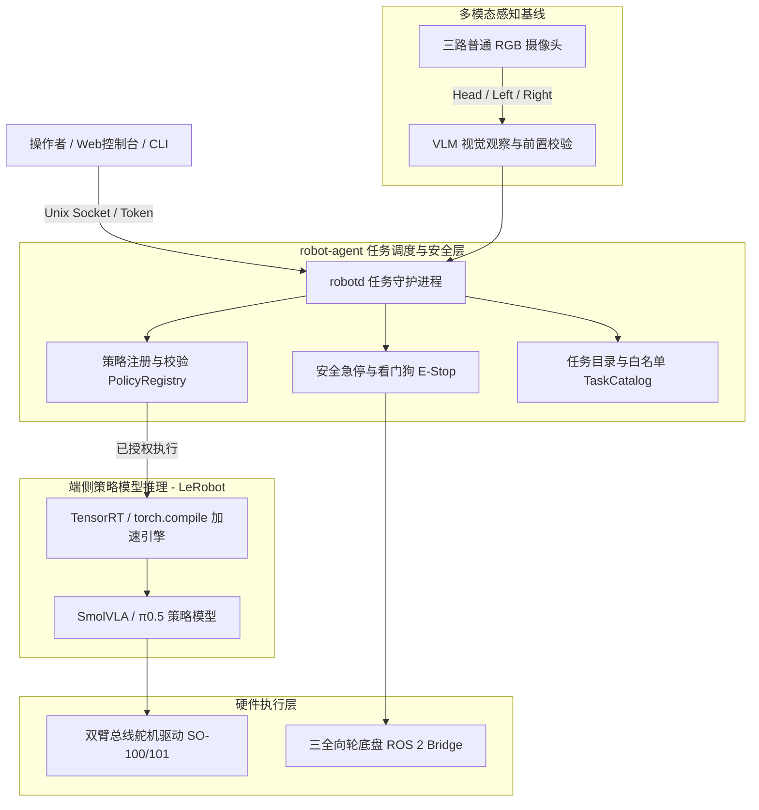

# XLeRobot: Embodied Household Service Robot

<div align="center">

[](LICENSE)
[](https://www.python.org/)
[](https://pytorch.org/)
[](https://github.com/huggingface/lerobot)
[](https://developer.nvidia.com/tensorrt)
[](https://www.nvidia.com/zh-cn/autonomous-machines/embedded-systems/)
[](robot-agent/tests)

**面向家用场景的具身智能双臂移动服务机器人全栈开源系统**
<br>
*涵盖端侧 TensorRT 策略加速、双臂与三全向轮实机驱动、高安全任务运行时与 Web 监管控制台*

</div>

---

## 🌟 核心特性与创新亮点

- ⚡ **端侧超低延迟策略加速 (Edge TensorRT Acceleration)**
  - 针对边缘嵌入式设备（NVIDIA Jetson Orin），实现了 **SmolVLA** 和 **π0.5 (pi05)** 的 ONNX 导出、TensorRT 引擎编译与 **BF16 / INT8** 量化。
  - 构建可插拔推理后端与平滑窗口过滤，降低端侧推理延迟；具体加速比随 JetPack、TensorRT 版本、
    模型与输入 shape 变化，以本机 benchmark 为准。
- 🤖 **4 项端到端家庭实机操作技能 (Household Manipulation Skills)**
  - **抹布抚平与折叠 (`fold_simple`)**：双臂协同抓取并折叠桌面平展织物。
  - **碗碟分类与叠放 (`stack_contrast`)**：多视角识别并将小碗叠放至中央托盘。
  - **桌面清理与毛巾摆放 (`pick_up_bottle_towel`)**：精细抓取小瓶并稳定放置在指定毛巾区域。
  - **物品收集与入筐整理 (`pick_up_bottle`)**：抓取桌面目标瓶子并回运放置入前置收纳筐。
- 🛡️ **安全约束的任务运行时 (`robot-agent`)**
  - **守护进程与严格隔离**：独立单实例后台服务 `robotd`，通过 Unix Domain Socket (权限 `0600`) 与 CLI/Web 通信。
  - **白名单与一次性 Token 授权**：动作执行前校验前置观察凭证、时间窗口与哈希绑定，彻底拒绝未知越权指令。
  - **软硬件急停边界 (E-Stop)**：支持进程组瞬时终止、看门狗心跳（250ms 速度归零 / 500ms 硬件失联停车）。
  - **高覆盖率工程质量**：核心运行时内置 **362 项全自动化测试（100% 通过）**，代码自包含且无冗余依赖。
- 🌐 **多模态感知与交互全栈闭环**
  - **纯 RGB 视觉基线**：基于三路低成本通用 USB 摄像头（头部广角 + 双手腕手眼视角），坚决不假定昂贵 LiDAR、深度或力传感器。
  - **Web 端一体化控制台**：实时查看三路相机画面、监视任务状态、在线触发家务技能、监管双臂数据集遥操作录制。
  - **全套遥操作支持**：已打通 VR 头显（WebRTC/XR）、Xbox 游戏手柄以及网络键盘遥测接口。

---

## 🏗️ 系统架构总览



---

## 📁 仓库目录导航

```text
├── robot-agent/         # 核心任务运行时（robotd 服务、Web 控制台、安全边界与 362 测试）
├── lerobot_0.3.3_pzy/   # [外部工作区] SmolVLA 端侧 TensorRT 推理与实机双臂驱动（不在本仓库）
├── lerobot_ycy/         # [外部工作区] π0.5 (pi05) 的 TensorRT 导出与量化（不在本仓库）
├── XLeRobot/            # [外部参考] 官方硬件 3D 打印件与仿真资产（不在本仓库）
├── integrations/        # LeRobot Jetson / π0.5 集成补丁（可审阅、无权重/大文件）
├── docs/                # 系统文档库
│   ├── hardware_bom.md  # 详细硬件物料清单 (BOM)、传感器规格与接线指南
│   └── history/         # 历史设计演进与开发日志
├── scripts/             # 环境快照与文档链接检查
├── archive/             # 历史实验分支与测试资产备份（已被 git 忽略）
├── .env.example         # 环境变量配置模板（代理、API 密钥、设备端口）
├── LICENSE              # Apache-2.0 开源协议
└── README.md            # 项目主入口说明
```

> **仓库边界**：`robot-agent`、文档与脚本可在本仓库独立运行；`lerobot_0.3.3_pzy`、`lerobot_ycy`、
> `XLeRobot` 是独立工作区，被 `.gitignore` 排除，克隆后不会出现。完整硬件复现需要单独获取这些
> 定制分支，详见 [复现指南](docs/reproduction.md#6-当前复现缺口)。

---

## 🚀 快速上手 (Quick Start)

### 1. 环境准备
推荐环境：Ubuntu 22.04 LTS (Jetson aarch64 或 PC x86_64)，Python 3.10+，已安装 Conda。

```bash
# 1. 复制配置文件模板
cp .env.example .env

# 2. 如果需要配置网络代理或 VLM 接口，编辑 .env
nano .env
```

### 2. 运行回归测试（验证运行时环境）
`robot-agent` 自带 362 项完整测试套件，验证安全状态机、Task Catalog、Token 机制及相机驱动：

```bash
cd robot-agent
pytest -q
```
*预期输出：`362 passed in ~11s`*

### 3. 启动 `robotd` 守护服务与 CLI 状态检查

```bash
# 启动守护进程
python -m robot_agent.service

# 在另一终端查看运行状态
python -m robot_agent.cli status
```

### 4. 启动 Web 可视化控制台
打开浏览器体验可视化任务控制与数据集录制：

```bash
python -m robot_agent.webui --port 8080
```
在浏览器访问 `http://localhost:8080`，即可进行机械臂使能、相机实时画面监视、家务技能触发和数据集录制。

---

## 🛠️ 硬件搭建与物料清单

完整硬件清单（包含舵机型号、底盘电机、电源降压方案及 Udev 绑定规则）请参阅：
👉 **[硬件选型与物料清单 (docs/hardware_bom.md)](docs/hardware_bom.md)**

- **机械臂**：双 SO-100 / SO-101 6-DOF 机械臂（飞特 STS3215 磁编码总线舵机）
- **移动底盘**：三轮全向底盘（120° 铝合金全向轮 + 轮速正交编码器 + 硬件失联停车看门狗）
- **感知相机**：三路通用 USB RGB 摄像头（`/dev/video2` 头部 + `/dev/video4` 左手腕 + `/dev/video0` 右手腕）
- **边缘算力**：NVIDIA Jetson Orin NX (16GB) / AGX Orin

---

## ⚠️ 模型权重范围 (Model Weights Scope)

本仓库定位为**框架与端到端管线**，默认不包含训练权重。仓库或本地出现的 checkpoint 是实验室参考产物，
不是下载即用的通用模型：

- 权重在固定的相机安装、光照、桌面高度、物体分布与机械臂标定下采集的数十条 episode 上微调，
  学到的是该配置的强先验，跨硬件/跨场景直接使用大概率失败。
- 视频与 demo 展示的是筛选后的成功片段，不代表统计成功率；真实指标以 benchmark 门禁报告为准。
- 复用权重必须重新采集数据、重新标定并训练，再通过 policy registry 绑定 SHA-256 与部署指纹。
- `dock_table` 桌沿对接、mission 恢复、安全急停与授权属于框架能力，不依赖特定权重。

完整边界与复用步骤见 **[模型权重范围与复用边界 (docs/model-weights.md)](docs/model-weights.md)**。

---

## 📖 详细文档索引

- **[模型权重范围 (docs/model-weights.md)](docs/model-weights.md)**：权重复用边界、过拟合风险与重新训练流程。
- **[复现指南 (docs/reproduction.md)](docs/reproduction.md)**：从零安装、dry-run、硬件闭环与训练/TRT 流程。
- **[LeRobot Jetson 集成补丁 (integrations/lerobot_jetson)](integrations/lerobot_jetson/README.md)**：基于上游 `1033680a5` 的可审阅补丁与验证脚本。
- **[π0.5 Jetson 集成补丁 (integrations/lerobot_pi05)](integrations/lerobot_pi05/README.md)**：基于上游 `473f1bd0e` 的 π0.5 TensorRT 补丁。
- **[已验证环境 (docs/environment.md)](docs/environment.md)**：JetPack、CUDA、TensorRT、PyTorch 实测版本矩阵。
- **[已知边界 (docs/known-limitations.md)](docs/known-limitations.md)**：未实现能力、安全边界与复现缺口。
- **[安全策略 (SECURITY.md)](SECURITY.md)**：漏洞报告、威胁模型与密钥卫生。
- **[发布流程 (docs/publishing.md)](docs/publishing.md)**：干净历史、发布前扫描与外部工作区策略。
- **[贡献指南 (CONTRIBUTING.md)](CONTRIBUTING.md)**：开发、测试、安全不变量与提交规范。
- **[硬件清单与电气接线 (docs/hardware_bom.md)](docs/hardware_bom.md)**：物料 BOM、舵机与相机 Udev 规则。
- **[RGB 桌沿对接 (robot-agent/docs/table-docking.md)](robot-agent/docs/table-docking.md)**：闭环视觉底盘对接与失效保护。
- **[任务编排与恢复 (robot-agent/docs/missions.md)](robot-agent/docs/missions.md)**：多技能串联、重试与恢复动作。
- **[具身智能服务机器人路线图 (robot-agent/docs/embodied-home-roadmap.md)](robot-agent/docs/embodied-home-roadmap.md)**：技术演进路线与准入边界。
- **[机械臂控制网页使用说明 (robot-agent/docs/web-ui-user-guide.md)](robot-agent/docs/web-ui-user-guide.md)**：Web 控制台使用指南。
- **[适配器契约设计 (robot-agent/docs/adapter-contracts.md)](robot-agent/docs/adapter-contracts.md)**：底盘与机械臂抽象接口说明。

---

## 📄 开源许可证 (License)

本项目采用 **[Apache-2.0](LICENSE)** 许可证开源。
与 [Hugging Face LeRobot](https://github.com/huggingface/lerobot) 开源生态保持完全兼容。
