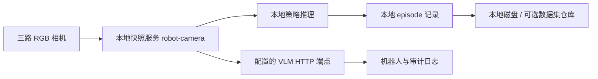

# 隐私与数据流 (Privacy)

本项目使用相机图像与 VLM 服务，部署者必须自行评估隐私与合规责任。

## 数据流

- **会离开本机的数据**：发送到 `VLM_API_URL` 的相机快照与提示文本。若使用第三方服务，图像可能
  包含人员、房间布局与屏幕内容。
- **默认留在本机**：策略推理、episode、审计日志、标定与权重。
- **不会自动上传**：本仓库没有遥测、崩溃上报或云端同步。

## 部署建议

1. 优先使用本地或局域网 VLM 端点；把 `VLM_API_URL` 指向受控服务。
2. 在 `.env` 中设置 `no_proxy`，避免快照误走外部代理。
3. 明确第三方服务的留存、训练使用与跨境传输条款；不要假设对方不保留图像。
4. 数据集与 episode 目录限制为当前用户访问；不要提交到公开仓库。
5. 公开 demo 视频前，对人员面部、屏幕、门牌与工位信息做脱敏。
6. 采集涉及人员的场景时，取得知情同意；提供删除与导出机制。

## 密钥卫生

- `VLM_API_TOKEN`、WiFi 密码、代理地址只放在未跟踪的 `.env` 或系统密钥管理中。
- 不要在前端、日志、episode、截图或 issue 中粘贴 token。
- 发布 fork 前重写历史；删除当前文件不会删除旧 commit 中的密钥。

## 事件响应

发现泄露时：立即轮换凭据、撤销 token、检查审计日志与访问记录，并按
[SECURITY.md](../SECURITY.md) 私下报告。
